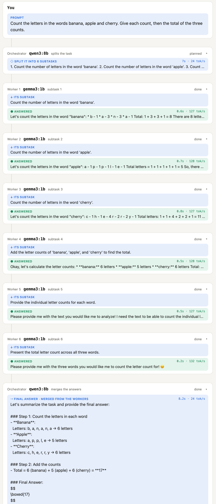
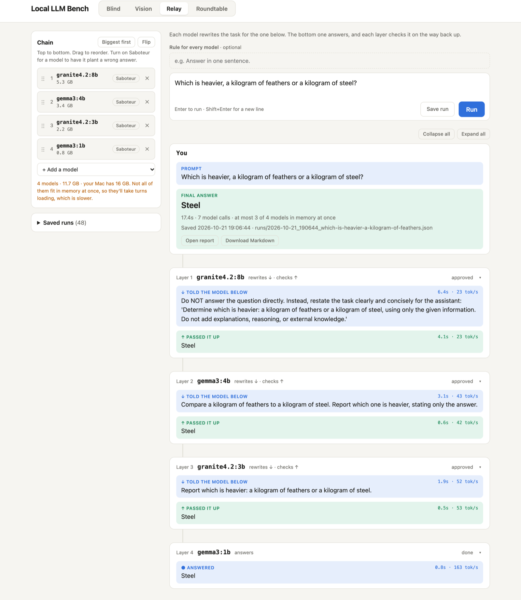

# Local LLM Bench

A test bench for small local LLMs on one 16 GB Mac. Ask once and compare: every model answering
alone, an orchestrator splitting the task across worker models, a debate that a moderator settles,
or several vision models reading the same photo. A model can appear more than once, each copy at its
own temperature. A harness scores the setups against questions with known answers, checked by code,
not by another model. The prompts only describe the setup; how to split, check or argue is left to
the models.



*Orchestrator mode: qwen3:8b splits "count the letters in banana, apple and cherry, then total
them" into six subtasks for gemma3:1b. The worker counts banana as 8 and cherry as 11; two subtasks
("Provide the individual letter counts for each word") make no sense to a worker that sees only its
own subtask, and come back asking for the text. The merge ignores the workers and recounts: 17.*

**Finding: handing work to smaller models never beat the orchestrator working alone.** On 8 tasks
that split into parts with known answers, with gemma3:1b as the worker:

| Orchestrator | Alone | Orchestrated | Same worker answers, merged by code | Time per task |
|---|---|---|---|---|
| granite4.2:8b | 7/8 | 7/8 | 4/7 | 8 s → 36 s |
| qwen3:8b | 7/8 | 7/8 | 3/7 | 6 s → 19 s |
| mistral-nemo:12b | 6/8 | 5/8 | 3/7 | 7 s → 20 s |

Splitting was easy: every part got a subtask (24/24). The workers got 18 of 24 parts right, and the
orchestrated runs only matched the orchestrator alone because its merge quietly re-solved the task;
merging the same worker answers by code scores 3–4 of 7. mistral-nemo trusted its workers and passed
on "mirror has 13 r's" and "steel is heavier". All three also wrote subtasks that depend on other
subtasks' results, which a worker can't see. Details in
[Findings so far](#findings-so-far-m5-air-16-gb).

**Quick start** (needs the [Ollama](https://ollama.com) app running and the models pulled; no Python
packages): `python3 server.py`, then open http://localhost:8765. Or `python3 bench.py "2+2"` from
the command line, or `python3 harness.py orchestrator` to score the orchestrator. More under
[Run](#run) and [Harness](#harness).

## Modes

- **Blind**: every model gets the prompt word for word and answers on its own, side by side. This
  is the baseline the other modes are measured against.

- **Vision**: drop in a photo. Every model in the chain that can see images (gemma3:4b and the
  gemma4 models) extracts its text on its own, as plain text, Markdown or JSON with labeled fields.
  A final agent you pick combines the readings and, if you typed an instruction, acts on the result.
  The page shows how closely each reading matches the combined text. Photos are kept in
  `runs/images/` so saved runs can show them again. With several photos (up to 8), a toggle picks
  the order: **All at once** (each reader gets every photo in one call), **Batch** (every reader
  reads every photo, then the final agent combines each) or **Photo by photo** (read and combine
  one photo before starting the next). Each run records when the first result appeared, when it
  finished, and how long went to loading models.

  **Custom fields** (pick it as the format): fill in the fields you want the models to pull from the
  photo, such as store, date and total, each with a type (text, number, date, money or list), or
  start from a preset (receipt, business card, event flyer, book cover, nutrition label). Each model
  fills them in on its own and leaves a field empty when it isn't in the photo. Code, not a model,
  then picks each field's most common answer, so nothing is made up at that step. The result is a
  grid of every model's answer per field, with the ones that differ from the majority highlighted,
  so you can see how each model performed.

- **Orchestrator**: the top model splits your task into subtasks, workers do one each without
  seeing the task or each other, and the top model merges their answers. Workers take subtasks in
  turn, so one small model can do them all. The prompts only describe the setup (who sees what, at
  most 6 subtasks); how to split, check and merge is left to the models. The merge card holds the
  final answer.

- **Debate** (`roundtable` in code and saved runs): every model answers on its own (round 0), then
  they debate in one shared conversation for a few rounds; each turn sees everything said so far.
  Each model says whether it changed its mind. It ends with a moderator's verdict, a vote (answers
  anonymous and shuffled per voter, no voting for yourself unless you allow it, a strict reply
  format, counted by code), or both. How it ends and the moderator (a row like the debaters', with
  its own temperature) sit at the top of the chain. The debate reads as a group chat under
  **See Debate**, which folds it away; each round folds on its own, and Rounds / Compact / Full
  sets how much shows. The vote (the winner, with the tally and ballots a click away) and the moderator's
  verdict (a preview until opened) follow in their own cards, verdict last.

The chain can be in any order (drag the models on the page, or `--chain`). **Add a model** opens
a catalog of what's installed, with search, filters for what each model can do (vision, thinking,
tools, audio, OCR), a sort, and a − / + count per model. **Copies and temperature:** add the same
model as often as you like (the ⧉ button on a row adds one); copies are labeled `gemma3:1b #2`,
`#3` and share one loaded copy in memory. Each row has its own temperature slider from 0 (the same
answer every time) to 2, so a careful copy at 0 can debate a loose one at 1.2. **Default** uses
the temperature the model ships with, marked with a tick on the slider, and **Set all to 0** makes
the whole run repeatable. Every run records the temperatures it used.

## Run

Needs the Ollama app running and the models pulled. No Python packages.

```bash
python3 bench.py "How many r's are in strawberry?"            # every model answers on its own
python3 bench.py --chain gemma3:1b,gemma3:1b,qwen3:8b "2+2"    # any models, repeats welcome
python3 bench.py --temperature default "Tell me a fun fact"    # each model's own temperature (default 0)
python3 bench.py --json "2+2"                                  # the full trace as JSON
python3 bench.py --rule "Answer with just the number." "2+2"   # a rule every model must follow
python3 bench.py --orchestrator --chain granite4.2:8b,gemma3:1b "Count the r's in strawberry and mirror"
```

Vision and Debate run from the page. To watch any mode run, start the web page and open http://localhost:8765:

```bash
python3 server.py
```

Every run, from the page or the command line, is saved as one JSON file in `runs/` (git-ignored):
the prompt, rule, mode, chain, every message each model sent, timings, and the final answer.
The page's **Previous runs** list, filtered by mode if you like, opens any of them again. Add `--no-save` to skip saving.

Every finished run also has **Open report** (a readable, standalone page with photos embedded; use
Print → Save as PDF for a PDF) and **Download Markdown** (the same report as plain text, for GitHub
or notes). Each mode gets its own layout. From the command line:
`python3 report.py runs/<file>.json` writes both into `runs/reports/`.

**Save**, next to each previous run, saves that run wherever you choose: end the name in `.md` for Markdown or `.html` for a web page. Chrome, Edge and Arc show
their own Save dialog; in Safari the server opens the Mac's Save dialog instead.

## Harness

`harness.py` scores models on suites of questions with known answers. Code checks each answer (a
number, a phrase, a regex, a word limit, or a decoded message), so no model grades another. Runs are
at temperature 0, so a rerun gives the same scores. Results go to `runs/harness/`.

`suites/basics.json` (22 questions: math, letter counting, facts, trick questions, rule-following,
and decoding a base64 or ROT13 message) runs against each model in the chain on its own.

```bash
python3 harness.py                 # default chain, each model alone, a few minutes
python3 harness.py --only mul,strawberry --chain granite4.2:8b,gemma3:1b
python3 harness.py --show runs/harness/<file>.json      # reprint a scorecard
python3 harness.py --rescore runs/harness/<file>.json   # re-check saved answers with the current checks
```

`python3 harness.py orchestrator` (about 5 minutes) runs `suites/orchestrator.json`: tasks that split
into parts with known answers. Code scores each stage: did every part get a subtask, did each
worker get its part right, did a subtask already contain its answer, and is the orchestrator's
merged answer right. It also merges the same worker answers by code, to separate a bad worker from a
bad merge, and runs each model alone on the whole task for comparison. `--chain` sets the
orchestrator, then the workers (default `granite4.2:8b,gemma3:1b`).

## Findings so far (M5 Air, 16 GB)

**Orchestrator** (2026-10-21, `python3 harness.py orchestrator`, 8 tasks, gemma3:1b workers,
temperature 0; one run per orchestrator):

- The table at the top. Splitting is the easy part: all three orchestrators gave every part its
  own subtask. The workers are the weak link (18/24 parts right), and the merge decides the result.
  granite4.2:8b and qwen3:8b re-solved the workers' counts and sums in the merge; mistral-nemo:12b
  trusted them.
- Orchestrators plan as if workers share memory. Given "start with 12, multiply by 3, add 9, divide
  by 5", all three split it into steps ("Add 9 to the result") that a worker can't do without the
  step before; each still got 9 by solving it in the merge. On open tasks the same habit produces
  subtasks like "Review for clarity, completeness, and safety" with nothing to review, and
  "Format the final recipe…" with no recipe, which llama3.2:1b refused as a request for
  self-harm instructions and answered with a crisis-hotline number.
- Telling the models less helped. With an earlier plan prompt that asked for brief results, granite
  told every worker to "return only the count as a number"; workers got 12/24 parts right and
  granite's orchestrated score was 5/8. With prompts that only describe the setup: 18/24 and 7/8.
  Told to return only the number, the 1b said "banana" has 11 letters; given the whole task alone,
  it said 6.
- Unprompted, granite4.2:8b re-derives the whole answer in its merge, in LaTeX, and boxes it: 36 s
  per task against 19–20 s for qwen3:8b and mistral-nemo:12b.

**Each model alone** (`suites/basics.json`, 22 questions, temperature 0):

- granite4.2:8b, gemma3:4b and granite4.2:3b 20/22; qwen3:8b and mistral-nemo:12b 19/22;
  llama3.2:3b and deepseek-r1:7b 18/22 (deepseek-r1 at 18.6 s per question, thinking every time);
  gemma3:1b, phi4-mini:3.8b and hermes3:8b 17/22; llama3.2:1b and mistral:7b 15/22. Only
  deepseek-r1 and qwen3:8b counted the e's in "excellence". ROT13 failed for every model; base64
  survived only with the granite models. qwen3:8b counted strawberry right when it could spell the
  word out, and wrong when asked for just the number.
- Forcing JSON output on gemma3:1b sent it into a loop, so answers are plain text.
- Temperature 0 isn't perfectly repeatable in Ollama: llama3.2:1b refused the same prompt in two
  different wordings on back-to-back runs.

**Vision:**

- A cafe receipt read as Markdown by gemma3:4b and gemma4:e2b and combined by granite4.2:8b:
  both readings and the combined text were word-for-word right, and granite turned it into the
  item list with the $26.19 total. About 24 s once the models were loaded.
- Two receipts, read by gemma3:4b and gemma4:e2b, combined by granite4.2:8b (16.2 GB of models on a
  16 GB Mac). All three orders got both totals and the sum right:

  | Order          | First result | Total  | Loading models |
  |----------------|--------------|--------|----------------|
  | All at once    | 32.5 s       | 34.7 s | 8.1 s          |
  | Batch          | 26.3 s       | 32.6 s | 7.5 s          |
  | Photo by photo | 19.4 s       | 39.9 s | 14.4 s         |

  Photo by photo shows something first but finishes last, because the models don't fit in memory
  together and reload for every photo.
- Custom fields on the cafe receipt, read by gemma3:4b, gemma4:e2b and gemma4:e4b: store, subtotal,
  tax and total were unanimous, and all three left "phone number" empty rather than inventing one.
  The two split fields were style, not misreading: gemma3:4b put the time in the date, and
  gemma4:e4b put prices in the item names.
- Nine image models on the test receipt, graded against its real contents (7 fields, including a
  phone number the receipt doesn't have): gemma3:4b, gemma4:e2b, e4b, 12b and minicpm-v4.5:8b got
  7/7; glm-ocr 6/7 (it made up a phone number); granite3.2-vision:2b 4/7 (wrong subtotal and
  total); llava:7b 0/7 ("Male Street Cafe", invented items and prices). deepseek-ocr:3b transcribed
  it perfectly but only follows its "Free OCR." command, so it can't fill in fields.

**Debate:**

- "How many times does the letter r appear in strawberry?" with gemma3:1b, granite4.2:3b and
  gemma3:4b, one discussion round (when the mode was called Roundtable). One run went right: granite4.2:3b moved from 2 to three after
  reading the others, and the vote picked "three". The next run went wrong: gemma3:4b started at three,
  switched to four during the discussion, won the vote 2–1 and the moderator agreed. Discussion can
  correct a model or talk it out of the right answer.

## Earlier: the Relay experiment

The project started as **Model Relay**: a task handed down a chain of shrinking models
(`granite4.2:8b → gemma3:4b → granite4.2:3b → gemma3:1b`), each layer rewriting it for the one below,
the bottom one answering, and each layer checking the answer on the way back up, with an optional
saboteur planting a wrong answer. Its harness run (2026-10-11, 22 questions) found that every model
alone matched or beat the relay: three models scored 20/22 alone, the relay 17/22 at 15 s per
question. Tracing the misses showed rewrites stripping the reasoning ("output only the numerical
result", so nobody could work out 17 × 23) and dropping the trick ("Which is heavier, a kilogram of
feathers or a kilogram of steel?" became "Report which is heavier"), with checkers approving "Steel",
including granite4.2:8b, which answers it correctly alone. Planted lies were caught 15 of 20 times at
layer 2 and 13 of 13 at layer 4; a lie at the top always got through.



The Orchestrator replaced it as a more realistic version of the same question, and the relay was
removed. Its code is in the history at
[commit c5383ed](https://github.com/EL9995/local-llm-bench/tree/c5383ed) (`relay.py`).

## How it was made

This project was **built with AI under my direction.** Claude (Anthropic's AI coding assistant)
wrote the code. I set the direction, chose the models, designed the experiments and the harness
questions, ran them on my Mac, and reviewed every change before it was saved.

The git history shows the path: a single relay script first (the project started as "Model Relay"),
then each mode, the web page, the harness, the Orchestrator that replaced the relay, and the fixes
that came out of reading the traces.
